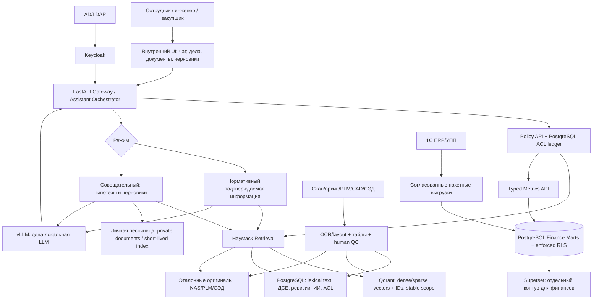

# Локальный корпоративный ИИ для машиностроительного предприятия РФ — архитектура v0.6 (Design Freeze P0)

**Дата ревизии:** 16 ноября 2026 г.  
**Версия исходника:** `manufacturing_onprem_ai_architecture_v0_5_adversarial_review_2026-11-16.md`  
**Основание:** перекрёстное ревью Gemini эталонного кода v0.5 и устранение четырёх дефектов: инвалидация кэша, задел, двуконтурный гибридный поиск, скрытые ИИ/шаринг.  
**Статус:** Design Freeze P0 по интерфейсам, инвариантам и границам подсистем; **не** подтверждённая промышленная реализация. Не заменяет обследование предприятия, испытания на его данных и правовое заключение.  
**Цель:** исправить реальные граничные случаи так, чтобы ранний пилот не превращался в одноразовую разработку.

## P0 Design Freeze: какие решения зафиксированы

**Фиксируем только основные границы и защитные инварианты, а не номера релизов/результаты измерений.** В рабочем проекте обязательны: Keycloak/OIDC → FastAPI Policy Gateway с authoritative PostgreSQL ledger → собственный retrieval adapter (Qdrant dense/sparse + PostgreSQL lexical/provenance) → изолированный vLLM; отдельный Metrics API и PostgreSQL BI; два режима verified/advisory; реестр ЕСКД/ЕСТД/ИИ/групповых чертежей и задела; личные пространства и проверка шеринга. Все системы работают локально, без cloud fallback.

**Отложены до испытаний, а не обещаны:** конкретные модели LLM/OCR/embeddings, throughput/TTFT, качество разборки чертежей, СУБД/резервные копии в промышленной топологии, количество GPU, интеграция с фактической конфигурацией 1С/PLM, требования КИИ/ГОЗ. Никакой компонент не получает статус production-ready по прохождению референс-тестов на SQLite.

**4 исправления v0.6:**
1. `move_document` атомарно меняет авторитетный scope и поднимает эпохи *исходной* и *целевой* областей плюс версию общего контекста авторизации; каждый ответ из кэша ещё раз проверяет права ко всем исходным документам. Вычисление ключа по прежней эпохе теперь не даёт авторизованный hit.
2. Применимость ИИ (графа 13) решается **до** применения указаний по заделу (графа 12): подтверждённая новая партия не требует строки `lot_directive` по старому заделу. Но `дата >= рубеж` сама не доказывает производство по новой ревизии; нужна запись о фактически применённой версии, иначе `NEEDS_REVIEW`.
3. Qdrant хранит `document_id`/`chunk_id`, стабильный `acl_scope_id` и **dense/sparse векторы, не содержимое фрагментов**; PostgreSQL отдельно хранит текст, метаданные, `tsvector`, точные обозначения. Встроенный Haystack `QdrantDocumentStore` не является готовым к такому контракту: нужен собственный адаптер или проверенная конфигурация интеграции. Стандартный BM25 Qdrant по текстовому payload при таком выборе не используется.
4. `change_notice` и все привязанные артефакты наследуют собственные `scope_id`/классификацию; verified/advisory подчиняются одним правилам. Если недоступное изменение мешает подтверждению актуальности, выдаётся нейтральное `CURRENTNESS_UNVERIFIED` **без прямого раскрытия факта/номера закрытого ИИ**; косвенный вывод по изменению статуса или времени ответа остаётся угрозой и требует отдельных испытаний. История беседы/экспорт/шаринг содержит полный provenance и перепроверяет полномочия каждого получателя при открытии.

## 0. Сверка 11 претензий и решения

| Претензия | Вердикт | Корректирующее решение |
|---|---|---|
| Superset использует один DB connection identity | Справедливо для распространённого способа подключения. `current_user` не меняется от web-пользователя автоматически | В пилоте Superset не служит персонализированным интерфейсом к секретным витринам; всем пользователям финансовые данные только через типизированный API с общим Policy Service. Отдельный Superset — для сотрудников финансовой службы с отдельными DB-ролями/витринами и тестами кэша. |
| Superset issue #39225 доказывает утечку `GLOBAL_ASYNC_QUERIES` | Указан **не тот номер как прямое доказательство**: #39225 озаглавлен `DB_CONNECTION_MUTATOR Does Not Switch Database`; в обсуждении обсуждают кэш. Для guest RLS + async известны отдельные #31492 и #24171 | Не включать `GLOBAL_ASYNC_QUERIES` или embedded guest-token dashboards для чувствительных данных без подтверждённого исправления в конкретной закреплённой версии. Включение `CACHE_QUERY_BY_USER` не является доказательством полной безопасности; кэш для чувствительных представлений выключить. |
| Предлагается обязательный `CACHE_KEY_WRAPPER` с `subject_id + access_epoch` | Направление верное, но `cache_key_wrapper()` — SQL/Jinja-макрос; не универсальная автоматическая защита всех кэшей Superset. Флаг `CACHE_QUERY_BY_USER` по документации Superset 6.1.0 по умолчанию `False` | Версионирование/инвалидация ALL relevant chart/filter/thumbnail/async/report caches либо их отключение для ограниченных данных; отрицательные cross-user тесты. Для персонализированного Superset — отдельная сертифицируемая техническая задача. |
| Чертёж содержит много исполнений, а v0.4 привязывает его к одному изделию | **Подтверждено**: `drawing.item_id` слишком узкая связь, ГОСТ 2.113-75 требует таблиц исполнений и групповых документов | `drawing` без обязательного `item_id`; связи `drawing_applicability` M:N на `item_variant` и документную ревизию. |
| `previous_value/new_value` не описывает вложенный эскиз или заменённый разрез | **Подтверждено** | `change_artifact` и `notice_target` с геометрической областью, страницей, ссылкой на эскиз, типом изменения и степенью формализации; числовые поля только как необязательный вариант. |
| Нет «Указания о заделе», условия внедрения по партиям/номерам | **Подтверждено** по ГОСТ Р 2.503-2023: графы 12 и 13 | `wip_disposition` для конкретных лотов/серий/изготовителей и `implementation_rule` с датой/номером изделия/заказом; аналитика effectivity не сводится к `effective_at`. |
| По неформализованному ИИ всегда отказ вместо полезной консультации | **Подтверждено как плохой UX**; отказ остаётся обязателен лишь для автоматического утверждения производственного решения | Два режима: подтверждённый нормативный ответ и консультационный разбор с сопоставлением кропов базового чертежа и ИИ, явным статусом гипотезы. |
| ACL поля `access_epoch` в Qdrant вызовут массовую перезапись при отзыве | Возможный серьёзный риск: v0.4 допускала epoch в описании `ресурс`, но не требовала обновления 500 тыс. чанков. Исправляем неоднозначность | В Qdrant хранить только стабильный `acl_scope_id`/`document_id` и поля для поисковой сегментации; полномочия, состав scope и `policy_epoch` только в PostgreSQL/Policy Service. Изменение членства не переписывает точки. |
| Запрос OpenFGA на 200 тыс. документов приведёт к длинному списку | Подтверждено для наивной реализации | Авторизация по стабильным областям, а не materialize разрешённые `doc_id`; bounded query plan и обязательная проверка результатов после retrieval. |
| Совещательный ИИ забыт | **Подтверждено** | Личная изолированная песочница, черновики, фото брака, обсуждения с provenance, сроком хранения, запретом общей индексации и тренировочного обучения. |
| OOM на 32 GB с MoE, OCR+embeddings и сбои на гомоглифах | **Риск подтверждён**, но 23–25 GB не универсальная измеренная величина; зависит от веса, квантизации, движка и контекста | Изначально GPU зарезервирован под одну LLM; OCR, embeddings/reranking на CPU или отдельном GPU; ресурсные лимиты и замер memory envelope. Канонический и исходный токены обозначений с контролируемыми confusables и сверкой реестра. |

### Исправления собственных прежних выводов

- `SET LOCAL app.subject_id` в PostgreSQL **недостаточно как самостоятельная защита**, если пользователь/запрос имеет возможность выполнить произвольный SQL и изменить собственный custom GUC. Нужна доверенная привязка идентичности к DB-операции, ограниченные DB-роли и интерфейс без SQL-произвола; самый простой вариант пилота — типизированный Metrics API.
- Индекс Qdrant **не является границей безопасности**: даже индексированный `acl_scope_id` обеспечивает только поиск кандидатов; каждый доступ к источнику и цитате проверяет authoritative Policy Service.
- `ГОСТ Р 2.503-2023` описывает применимость и работу с заделом, а не единственную дату новой редакции. Алгоритм «всегда брать последний документ по дате» недопустим.
- Утверждение «поменять членство за 1 мс» не доказано: требуется проверка транзакционной фиксации, задержки инвалидирования caches, стриминга и распределённой репликации.

---

## 1. Конечная архитектура: одна система, два режима работы

**Хранилище секретных директорских ведомостей** не входит в общую схему. При реальном требовании работать с ними — отдельный контур и специальная роль; в первых этапах система не видит этих данных вообще.

**Компоненты:** Keycloak, FastAPI, Haystack (orchestration, custom retriever), Qdrant, PostgreSQL, Docling/PaddleOCR, vLLM, BGE-M3 embedding и совместимый реранкер после теста, Qwen/Qwen3.5 или альтернатива после теста; Apache Superset только в ограниченном финансовом сегменте. Исходники и модели — локальные, без внешних API. Сканеры и действующие ERP/PLM/СЭД — *имеющаяся инфраструктура предприятия*, не бесплатное OSS.

---

## 2. Финансовый контур: устраняем session-pool и cache leaks

### 2.1 Минимальный безопасный вариант

1. В пользовательском чате **нет прямого Superset UI/API, SQL Lab, Query Explorer или произвольного SQL**. Любые показатели читаются через типизированный `Metrics API` (`get_plan_fact`, `get_project_margin`, `get_purchase_price_series`), где набор запросов и параметры заранее утверждены.
2. Gateway валидирует OIDC и получает `subject_id`/актуальные права **серверным** каналом; параметр `subject_id` из JSON пользователя игнорируется.
3. Каждый запрос Metrics API выполняет transaction-scoped policy check по ресурсам и scopes. SQL-роль чтения не `SUPERUSER`, не владелец таблицы, не `BYPASSRLS`; для защищённых таблиц включить RLS и (при необходимости) FORCE RLS. БД не доступна клиентам напрямую.
4. На начальном этапе наиболее безопасны **отдельные витрины по классам допуска с разными сервисными ролями**; детали row-level/per-person-level проекта отдаёт только Metrics API. Это позволяет не внедрять хрупкий dynamic SQL в Superset ради удобства панели.
5. Для реализации динамического RLS допустим доверенный `SET LOCAL` в **той же транзакции и на том же соединении**, что и SQL-запрос. Но пользователь не имеет ни доступа к SQL-вводу, ни контроля над этим `SET`. Custom GUC не считается криптографическим удостоверением личности. Проверять, не допускают ли запросы SECURITY DEFINER, views, функции или права роли обхода RLS.
6. Результаты с малым числом контрагентов/заказов могут раскрывать закрытые сведения через агрегирование; отдельные правила minimum group size и sensitivity review.

### 2.2 Superset: не считать одним сервисным соединением персональную RLS

- Факт: при подключении стандартным URI Superset выполняет запросы к БД как **настроенный DB principal**, а не автоматически как сотрудник, вошедший в web UI; `current_user` в SQL для всех таких соединений одинаков.
- В **пилоте** Superset доступен только финансовым аналитикам с выделенной ролью/витринами, не сотрудникам цеха. Дашборды для работников строит свой UI поверх Metrics API.
- Если заказчик требует персонализированную многоарендную Superset-инсталляцию, это **отдельная ветка проектирования**, для которой нужны DB-per-tenant/user roles либо доказанная безопасная связка identity propagation и SQL-пулов в конкретной версии. Динамическое `SET LOCAL` без проверки пользовательского кэша и выполнения в одном транзакционном контексте не принимается.
- По умолчанию `CACHE_QUERY_BY_USER` у Superset 6.1.0 — `False` (это **feature flag**, а не гарантированная независимая глобальная функция). Включение `True` само по себе не учитывает отзыв прав, где username не изменился. Для чувствительных данных отключить query/data caching, thumbnails, warmup, отчёты, async chart queries, guest-token embedding, сохраняемые пользовательские параметры фильтров, до отдельного испытания.
- `cache_key_wrapper()` — Jinja-макрос для включения данных в SQL cache key, а не универсальная защита preview, native filter, screenshot, async, URL экспорта. Не закладывать в архитектуру пользовательский `CACHE_KEY_WRAPPER` как выдуманную одну волшебную настройку.
- Для оставшихся cache-backed функций — отдельная область кэша по trust-zone и role; отсутствие кросс-выдачи проверяется на **любой** комбинации пользователей, проектных ролей, отзыва и повторного входа. При невозможности доказать изоляцию — функцию отключить.

### 2.3 Контрактные тесты (P0)

- У директора и мастера один дашборд по проекту: мастер никогда не получает data/URL/export/thumbnail/filter из контекста директора, даже после его посещения, смены ролей и завершения сессии.
- Прямой вызов HTTP endpoints Superset и Metrics API c валидным токеном другой роли, с просроченным JWT, с подменённым subject и с отключённым авторизатором — fail closed.
- Проверить отсутствие bypass через SQL owner/BYPASSRLS, views SECURITY DEFINER, SQL Lab и разницу в permissions database vs web app.
- Проверить `cache warmup`, async readback, фильтры, PDF/CSV экспорт, thumbnails, dashboard shares, Alerts & Reports (или доказать, что выключены).

---

## 3. ACL без массовой перезаписи векторного индекса

### 3.1 Разделение ресурса и разрешения

- **В Qdrant**: `tenant_id`, `document_id`, `chunk_id`, стабильный `acl_scope_id`, минимальные несекретные признаки технического поиска (`designation_key` только после классификации, `item_family` — если разрешено), dense+sparse embeddings. Не хранить ни `access_epoch`, ни личные grants, ни plaintext/chunk body в payload. Сами embeddings и идентификаторы **также потенциально чувствительны**, так что Qdrant — защищённый внутренний сервис; индексировать `acl_scope_id` как keyword.
- **В PostgreSQL**: защищённые `chunk_source(chunk_id, document_id, body, source_hash, page_no, bbox, revision_id)` и `chunk_search(chunk_id, tsvector, designation_key)` для словесного/точного поиска; RLS и права на оригинал контролируются Policy API. Текст не возвращается с первой стадии retrieval — только после повторной авторизации на read.
- **Haystack**: использовать Pipeline как orchestration, но **не** считать штатные `QdrantDocumentStore`/`QdrantHybridRetriever` готовой реализацией без текста в Qdrant payload. Зафиксировать кастомный read/write адаптер: выдаёт только candidate IDs и scores, суммирует dense+sparse+SQL lexical результаты, затем запрашивает текст и ссылки по Policy API; отдельно тестировать обновление и удаление точек, no-result/fail closed.
- **В PostgreSQL ACL ledger**: `scope(id, parent_id, classification, tenant_id, status)`, `subject_scope_grant(subject_id, scope_id, role, valid_from, valid_to)`, `group_scope_grant(...)`, `membership(...)`, `policy_epoch`, `acl_event`, `document_scope(document_id, acl_scope_id, valid_from, valid_to)`. Это authoritative source.
- Стабильный идентификатор scope не меняется от смены участников. Поэтому обычный отзыв участия в группе меняет записи в ledger/epoch, а **не 500 тысяч Qdrant points**.
- Когда **сам документ меняет область** (перенос, переклассификация, разделение доступа), обновление части payload/реиндексация может быть необходима. До её завершения документ должен быть заблокирован на fetch независимо от устаревшего индекса. Безопасное поведение — fail-closed, затем publish нового индекса.

### 3.2 Алгоритм retrieval и отзыва

1. На входе получить актуальные гранты и версию policy. Получить **компактные** разрешённые scopes; если их слишком много, не превращать это в строку из сотен тысяч `doc_id`: использовать иерархическую/сегментированную модель разрешений и подходящий bounded query plan, результаты которого профилируются.
2. Поиск в Qdrant с предфильтром по scopes, классификации, арендатору и техническим признакам. Qdrant возвращает **только IDs и scores**, без текста секретных фрагментов; экземпляр недоступен из пользовательской сети.
3. Все candidate document IDs проходят **батч-проверку в Policy Service** на актуальную версию, в том числе перед fetching embeddings/document content для reranker, перед отправкой в модель, перед citation/preview/download и перед tool calls.
4. При изменении membership/policy: атомарно фиксировать ledger+epoch (в том числе **при переносе/переклассификации документа**) и создавать событие в transactional outbox для обновления поисковых метаданных. `move_document` повышает epoch прежней и новой областей **и** общую `policy_generation`. Кэш ответа идентифицирует subject, tenant, контекст, генерацию, модель и источники; на cache hit повторно проверяется актуальная авторизация и provenance. Для потоков — повторная проверка до публикации каждого чувствительного блока и прерывание при отзыве. Открытое ранее содержимое нельзя изъять из памяти пользователя.
5. **Для первого выпуска** общий монотонный `policy_generation` проще и безопаснее локальных эпох, хотя даёт лишние cache misses; последующая оптимизация на подписанный fingerprint затронутых областей возможна только по результатам тестов. **Не** считать инвалидированием одно лишь повышение номера — ни готовые файлы на публичных URL, ни скопированный текст так не удаляются.
6. История ответа, результаты личного поиска, previews и links сохраняются с **идентификаторами источников** и требуют повторной авторизации при открытии после отзыва; запрещено показывать старый зашифрованный «кэш готового ответа» без права на прежний источник.
7. Когда policy DB недоступна — никакого fail-open и выдачи cached secrets. Для статических общедоступных документов допустим отдельный публичный контур.

**Риск:** предфильтрация десятков тысяч **scopes** тоже может оказаться затратной. Поэтому профилировать не только число документов, но и количество уникальных scopes/профилей у каждого сотрудника, RLS cardinality, p95/p99 и cache invalidation latency.

### 3.3 Контракт кэша и производных ответов (P0)

- Никакого user-supplied `subject_id`, `scope_id`, `epoch`, `is_admin`: источник идентичности — проверенный OIDC + серверный Policy API.
- В кэше `sources = {document_revision, change_notice, file, draft, metric_mart}` и `policy_generation` обязательны. Cache entry без полного provenance — **miss / deny**, даже если в ответе нет цитат: LLM могла вывести вывод из закрытого источника.
- `GET /threads/{id}`, предпросмотр, HTML/CSV/PDF экспорт, повторное воспроизведение и share-link выполняют новые проверки получателя ко **всем** источникам и к производным вложениям. При невозможности корректно удалить запрещённый фрагмент — блокируется **весь** ответ, а не только ссылка на источник.
- Невозможно гарантировать «отзыв уже прочитанного»: пользователь мог сохранить скриншот/экспорт. Контроль работает на **новые обращения** и управляемые кэши, плюс аудит.

---

## 4. Модель инженерной истины: групповые документы, изменения, партии

### 4.1 Логическая модель, заменяющая одно-ко-многим из v0.4

- `item(id, base_designation, item_type, lifecycle_state)`: ДСЕ/изделие; не заставлять все позиции иметь единственный неизменный вид обозначения.
- `item_variant(id, item_id, full_designation, execution_suffix, variant_status)`: исполнение `-01`, `-02` и т.д.; полное обозначение и источник обязательно сохраняются.
- `variant_property(item_variant_id, property_code, value, uom, source_artifact_id, reviewed_at)`: измерения/материал/параметры таблиц исполнений, уникальность на набор ключей/version/effectivity.
- `drawing(id, drawing_designation, source_file_id, checksum, classification)`: самостоятельный групповой/единичный чертёж **без** обязательного `item_id`.
- `drawing_applicability(drawing_id, item_variant_id, document_revision_id, valid_from, valid_to, effectivity_rule_id)`: связь **M:N**; одна ревизия чертежа покрывает много исполнений.
- `document_revision(id, document_id, revision_code, approval_status, approved_at, valid_from, valid_to, provenance)`: сохранять revision+source, не угадывать по имени файла.
- `bom_edge(parent_variant_id, child_variant_id, quantity, unit, applicability_rule_id, revision_id, valid_from, valid_to)`: состав по исполнениям, сериям/заказам/партиям.
- `change_notice(id, notice_number, notice_kind, issue_date, approval_state, source_file_id, acl_scope_id, classification, registry_visibility)`: ИИ/ДИ/ПИ/прочие типы; само существование закрытого ИИ может быть закрытым метаданным. Все `notice_target`/`change_artifact` наследуют минимум эту классификацию либо более строгую.
- `notice_target(notice_id, document_revision_id, item_variant_id NULLABLE, target_type, bbox NULLABLE, page_no NULLABLE, description)`: одно извещение затрагивает много ревизий, страниц и исполнений.
- `change_artifact(id, notice_target_id, artifact_type, file_id, page_no, bbox, source_hash, structured_patch JSON NULLABLE, review_state)`: эскиз, новый разрез, вклейка, отсканированный фрагмент и необязательная структурированная поправка; **нет** требования `previous_value/new_value`.
- `implementation_rule(id, notice_id, plant_id, order_id NULLABLE, series_from/to, serial_from/to, effective_from/to, condition_kind, condition_text, approved_by, approval_state, provenance)`: **графа 13**; правило может зависеть от номера, заказа, цеха, даты, исчерпания задела, графика ТПП. Неформализованные или неутверждённые правила нельзя трактовать по дате автоматически.
- `wip_disposition(id, notice_id, plant_id, lot_id NULLABLE, serial_scope, instruction, instruction_text, drawing_artifact_id NULLABLE, approved_by, provenance)`: **графа 12** относится к заделу, произведённому по старой редакции до рубежа внедрения. `use`, `do_not_use`, `rework`, `unaffected`, `unknown`, `no_stock` и ограничения на количество комплектов — условия для **старого задела**. «Не отражается» означает отсутствие влияния изменения на использование задела, а не автоматическое разрешение произвольной новой партии.
- `production_lot(id, item_variant_id, manufacturing_date, serial_range, order_id, plant_id, status, produced_under_revision_id, revision_evidence_id, source_erp_batch)`: партия/экземпляр, подтверждение **реально использованной** ревизии (маршрут/операция/отметка 1С/PLM); одного календаря внедрения недостаточно.
- `evidence_link(id, entity_type, entity_id, source_file_id, page_no, bbox, approved_at, reviewer)`: provenance каждой критической величины; может ссылаться на внешнюю СЭД/PLM.

**Не усложнять искусственно:** это предметные сущности и связи для проектирования, а не финальный DDL. Окончательные ограничения, nullability и индексы определяются по конкретным архивным формам и PLM/1С предприятия. При необходимости `recorded_from/recorded_to` обеспечить бивременную историю: когда изменение *действовало* и когда *стало известно* системе.

### 4.2 Протокол запроса о детали

1. Найти **оригинальное обозначение** и канонический алиас, получить все исполнения, сверить по номенклатуре владельца и требуемой конфигурации изделия.
2. Разрешить маршрут `изделие → вариант исполнения → применимые чертежи/ревизии → зарегистрированные ИИ/ПИ/ДИ → указания о внедрении → задел партии/серии/заказа`.
3. Для конкретной партии/серии/заказа сначала разрешить **условие внедрения** по графе 13 и подтвердить фактически применённую ревизию. **Если партия уже изготовлена по подтверждённой новой ревизии**, не требовать для неё `wip_disposition`, относящееся к старому заделу. Если правило внедрения неполное/неутверждённое либо ревизия партии не подтверждена — `NEEDS_REVIEW`. Для **старого задела** применить графу 12 с учётом количества/серии/завода и состояния продукции; нельзя автоматически переносить указание на будущие партии.
4. Получить исходный чертёж и **доступные пользователю** изменения с указанием страниц и координат; разрешить доступ к каждому источнику отдельно. Полнота нормативной истины вычисляется в доверенном реестре с учётом **и скрытых** изменений; если актуальность нельзя доказать доступными пользователю данными — не выдавать допуск. Нельзя показывать номер/сам факт закрытого ИИ, если его метаданные классифицированы; безопасное объяснение: `CURRENTNESS_UNVERIFIED` / «Не удалось подтвердить актуальную редакцию».
5. В нормативном режиме выдать только параметры с утверждённым извлечением, проверенным источником и утверждённой применимостью. Неполнота => `NEEDS_REVIEW`, без команды для станка.
6. В совещательном режиме показывать только **разрешённые** кропы, эскизы и фрагменты ИИ; разрешать гипотезы, но никогда не описывать исходный чертёж как безусловно актуальный при `CURRENTNESS_UNVERIFIED`. Статус `HYPOTHESIS`, запрос на инженерную проверку и отказ от производственного утверждения обязательны.
7. При публикации/шеринге диалога любому другому лицу повторять проверки ко всем источникам **включая извещения, черновики и производные ответы**. Утраченные полномочия блокируют старые ссылки и записи истории; метаданные закрытых документов тоже не раскрываются.
8. Инженер может утвердить структуру конкретного изменения/исполнения; публикация в канонический реестр — отдельный workflow с авторством и журналом. LLM не подписывает/не утверждает нормы.

### 4.3 Минимальные граничные кейсы

- Групповой чертёж с исполнениями `АБВГ.712345.004-01 … -25`, разные материалы/длины: один оригинал, корректные ссылки на все варианты; отсутствие случайного склеивания материалов.
- Два ИИ к одному базовому чертежу, одно — эскиз, другое — замена разреза А-А: не потерять ни одно; overlay показать без «выдуманного числа».
- Извещение: `Использовать задел 5 комплектов`, затем `Доработать согласно эскизу` для другой серии: ответ зависит от номера партии/серии.
- Изменение действует для завода А с №007, для завода Б — по получении: универсальной даты недостаточно.
- Текущая применяемая ревизия отличается от самой поздней загруженной в архив: выбор — по PLM/утверждённым ИИ, не по timestamp OCR.
- Скрытое ИИ к доступному чертежу: обычный мастер получает `CURRENTNESS_UNVERIFIED`, но не номер, дату, наименование либо факт существования секретного ИИ. Инженер с соответствующим ACL видит доступные ему доказательства.
- Пост-эффективная партия с подтверждённой ревизией: `NEW_REVISION` без обязательной строки в `wip_disposition`; если дата уже после рубежа, но фактическая ревизия неизвестна — `NEEDS_REVIEW`.
- Публичная ссылка на совещательный ответ, вычисленный по секретному ИИ: реципиент не получает ни историю, ни её summary, ни экспорт без новых полномочий. После перевода исходного документа в закрытую область ранее выданная ссылка перестаёт открываться.

---

## 5. Два режима ИИ, сохраняющие бизнес-ценность

### Нормативный (`verified`)

Использование: ГОСТ/ТУ/ЕСКД/ЕСТД, допуски, допуск детали к производству, соответствие регламентам, утверждённая себестоимость, расчёты. Ответы содержат применимую ревизию, дату/партию, источники, логический статус `VERIFIED / NEEDS_REVIEW / NO_AUTHORIZED_SOURCE`; численные поля сверены с оригиналом/уполномоченным инженером. При нехватке доказательств — не утверждать параметр как достоверный.

### Совещательный (`advisory`)

Использование: поиск аналогов, гипотеза причины брака, оценка альтернативного материала, план ремонта, черновик ТУ/техпроцесса, сравнение вариантов, фото неисправности и обсуждение. Модель предлагает идеи и указывает их статус `DRAFT / HYPOTHESIS`; **не** оформляет автоматически производственное разрешение, не меняет PLM/1С/станки и не «одобряет» безопасность процесса. Можно отвечать при неполном документе, явно обозначая недостаточную подтверждённость, **не раскрывая наличие, номер или название секретного ИИ**. При невозможности подтвердить актуальность открытого чертежа advisory не должен использовать его как действующий норматив; допускаются только гипотезы и запрос на проверку.

Смена режима не расширяет пользовательский ACL. При любом инструментальном вызове — policy check и allowlist. Высокорисковые рекомендации (например, безопасность станка, критичные допуски) требуют подтверждения компетентного сотрудника.

### Личные песочницы

- Временные документы `user_private`/`session_private` сохраняются отдельно от общего индекса и общего хранилища. Доступ `owner_only` по умолчанию. TTL/retention устанавливается политикой завода; пользователь может удалить разрешённые черновики. Запрет на скрытое дообучение или выгрузку во внешние сервисы.
- Фото брака, проект ТУ, переписка, черновой расчёт — только в рамках текущего контекста, имеют источник/время/владельца/классификацию. Общий RAG получает только явно одобренную публикацию через отдельный workflow с наследованием классификации.
- Для небольших сессий возможен in-memory/SQLite/FAISS temporary index либо обычный текстовый контекст без отдельной векторной базы; **не** обязательный второй полноразмерный Qdrant. Если черновик включает сведения из закрытого документа, его производная классификация не ниже исходной.
- При отзыве доступа или переносе документа поднимаются эпохи исходного и нового scope и общая версия политики. При чтении/шеринге беседы обязательно перепроверяются все source dependencies, а не только её владелец. История без полного provenance не может быть расшарена. **Содержание скрытого ИИ не пересказывается через advisory, summaries, citations или tool outputs.**
- При отзыве доступа к документу производные кеши/история в разрешённых границах инвалидируются. Архив журнала аудита сохраняется в соответствии с корпоративными правилами, не должен быть общедоступным.

---

## 6. OCR и точные обозначения после распознавания

### Двухканальное извлечение

**Канал А — человекочитаемый**: исходный crop, OCR-текст, bbox, confidence, кодировка, источник, версия; буквенная последовательность никогда не перезаписывается «починенной».

**Канал Б — технический поиск**: нормализованная строка в *контексте поля*, варианты confusables, именованные группы/коды, алиасы из канонического справочника и точные идентификаторы изделия.

**Конфузаблы:** `Х/X`, `С/C`, `А/A`, `В/B`, `Е/E`, `К/K`, `М/M`, `Н/H`, `О/O/0`, `Р/P`, `Т/T`, `У/Y`, `І/I/1` и другие. Замена допустима **не глобально**, а только в распознанных технических полях и после проверки допустимого алфавита и формата. Нельзя автоматически делать `0 = О` в любом контексте: можно склеить два разных допустимых номера. В журнале сохранять `original_value`, `normalized_candidates`, `canonical_id`, `match_type`, `requires_review`.

### Поиск

1. `exact` по исходному и проверенным каноническим ключам PostgreSQL реестра номенклатуры.
2. `alias/confusable candidate` с контролируемым набором вариантов и рейтингом; ambiguous candidates не объединять молча.
3. **Двухконтурный гибридный поиск:** PostgreSQL `tsvector`/`tsquery` и отдельные B-tree поля точных обозначений — по тексту, кодам, артикулам и ГОСТ; Qdrant — **dense и/или sparse embeddings**, предвычисленные на закрытом ingest-worker. SQL full-text ranking (`ts_rank`/`ts_rank_cd`) — не тождественен классическому BM25; если нужен именно BM25 по SQL, отдельно выбрать, лицензировать и испытать подходящее расширение. Встроенный BM25 Qdrant на текстовом payload не использовать при принятом принципе «нет plaintext в Qdrant».
4. После сопоставления с реестром — поиск допустимых documents/variants по ACL; кандидаты из SQL и Qdrant объединяются через **собственный адаптер Haystack**, а затем контент гидратируется из PostgreSQL по актуальным правам перед reranker/LLM. Обычный `QdrantDocumentStore` ожидает полноценные `Document(content=...)` и не гарантирует этого контракта «ID-only». Запретить UI/API прямого доступа к поисковым индексам.
5. Фактическое утверждение опирается на подтверждённый номер, ревизию, применимость и источник, а не один OCR confidence. Кэш результатов ранжирования рассматривается как потенциально чувствительная производная данных.

**Обязательные тесты:** смешанный ввод `12Х18Н10Т`/`12X18H10T`, артикулы `АБВГ.712345.004-02`, числовой `0` против буквы `О`, смешанная кириллица/латиница с именем заказчика, номер по таблице исполнений, ложные синонимы, отказ от угадывания при неоднозначности.

---

## 7. 32 GB VRAM: план разделения ресурсов без обещания производительности

- На первом GPU 32 GB работает **один** vLLM/Qwen serving process. Запретить «по умолчанию» GPU OCR/Docling/PaddleOCR/embedding/reranker на этой же карте. Для OCR и embedding используются CPU worker-пулы с ограничением `memory.max`, `cpu.max`, числом процессов, очередями и лимитами PDF/page/tiles. При высокой нагрузке — отдельная GPU для OCR или ускоренный inference узел.
- Исходный benchmark: **Qwen3.5-9B** с фактическим BF16 memory/latency профилем. Сравнить квантованную **Qwen3.5-35B-A3B** как альтернативный профиль, а не обещать её работоспособность по арифметике весов. Если в выбранном движке/квантизации она занимает большую часть VRAM и теряет throughput — не использовать на RTX5090.
- В измеренный GPU envelope включить `weights + quant scales + visual encoder + runtime/CUDA graphs + KV cache + concurrency + fragmentation`, с резервом под пики. `gpu_memory_utilization`, максимальный контекст, `max_num_seqs`, batch size и KV cache — фиксировать **после профилирования** конкретного образа. Не использовать `35B × 0.5 bytes` как прогноз реальной VRAM.
- Установить admission control: ограниченное число одновременных запросов, очередь, отмена/таймаут, защищённый приоритет критических запросов, backpressure, health/oom watchdog; при выходе за лимит выдавать контролируемую ошибку/отложенную задачу вместо падения системы.
- Не выполнять фоновую дистилляцию 235B/671B на этой машине. Никаких GPU-unlock-патчей в производственном baseline. MIG к одной RTX5090 не применяем.
- Тесты: 1/2/4/8 пользователей, текст 4k/8k/16k, image crops, OCR A0 одновременно на CPU, три параллельных больших документа, замеры p95/p99 TTFT/latency и VRAM peak, restart worker on OOM. По результатам определить число GPU и допустимые профили.

---

## 8. Защита от утечек при DLP, SSE и tool calls

Оригиналы штампов, договоры, ФИО, ИНН, суммы не «анонимизируются» в эталонном архиве. DLP работает на **границе публикации/экспорта**; риск некорректной маскировки не переносим в исходники. Для личных черновиков и advisory-режима — та же авторизация и отдельные функции Redaction Preview, если политика требует обезличивание копии.

SSE не нужно подавать покусочно в ICAP. Для чувствительного класса ответ собирается целиком, проходит проверку допустимости и лишь после неё отдаётся клиенту. Для низкого класса доступен streaming с повторной проверкой эпохи на долгих ответах. Любой инструментальный JSON-объект проверяется на схему и на права конкретного ресурса. Инъекции в OCR/GOST/captions не становятся исполняемыми инструкциями.

---

## 9. Реализация без одноразового пилота: последовательность и критерии

**Этап 0 — обследование:** классификация источников и пользователей, СЭД/PLM, формат ГОСТ, интерфейсы 1С, реальная структура файлов и версий, объем архивов, требования физической/юридической изоляции, проверка лицензий OSS и весов. При наличии ГОЗ/значимого объекта КИИ — отдельное legal/ИБ обследование.

**Этап 1 — защищённый прототип:** Keycloak + Policy API + registry + Haystack/Qdrant + typed Metrics API; 3–5 пользователей, 100 документов и 30–50 групповых чертежей, плюс 2–3 серии/ИИ/задела на изделие. Superset отдельно в группе финансистов. Только тестовые/обезличенные данные.

**Этап 2 — OCR и эксперименты:** Docling/PaddleOCR и гибридный retrieval на рабочих сканах, разметка полей гомоглифов, сравнение RAGFlow без переноса прав, A/B Qwen3.5-9B vs 35B quant после memory profiling. Отбор по точности и цене производительности.

**Этап 3 — эксплуатационные испытания:** интеграция с согласованной копией 1С/PLM, безопасность BI, авторизация, отзыв доступа в середине stream, кэш, восстановление, offline, performance с сотнями тысяч scope/document records.

**Внедрение:** версия и план rollback, подписанный manifest контейнеров/весов/зависимостей, журнал полномочий, перенос доверенной схемы без исходящего интернета, ежедневные бэкапы с проверенным восстановлением.

### P0 инварианты приёмки

1. После отзыва grant **или переноса документа между scopes** ни одна **новая** операция чтения документа, ссылки, старого ответа, файла, эмбеддинга, BI-графика или tool call не должна проходить — независимо от устаревших Qdrant points и клиентского кэша. Ограничение: ранее полученную пользователем информацию отозвать невозможно.
2. Кросс-пользовательский cache-тест Director→Foreman, Foreman→Director, role-change same-user, `GLOBAL_ASYNC_QUERIES`/guest disabled либо протестирован на изоляцию, dashboard exported link: **0 наблюдаемых нарушений** на тестовом наборе. Без прохождения — персонализированный Superset не запускать.
3. Групповой документ связан с несколькими вариантами; не допускается перепутать вариант исполнения и материал.
4. На заданный номер изделия и партии не перепутаны `use`, `rework`, `do_not_use`; после утверждённого рубежа новая подтверждённая ревизия не требует старой директивы о заделе; неизвестные ограничения — `NEEDS_REVIEW` для нормативного ответа, но консультационный UI показывает доступные источники и объяснение.
5. `Change Notice` с эскизом/перерисованным разрезом отображается в правильных координатах; система не выдумывает числовую diff-пару.
6. Canonicalizer ищет нужные источники при смешанных алфавитах, но не автоматически объединяет легитимно разные изделия `0` и `О` без authoritative reference.
7. В выбранном режиме на RTX5090 отсутствуют GPU OOM при утверждённой пиковой нагрузке, даже при параллельном CPU OCR; при нехватке ресурсов есть корректный отказ или очередь.
8. Нормативная выдача невозможна без применимой ревизии, provenance и достаточного права на **все** нормативные источники, включая действующие изменения и указания о заделе. Если закрытое ИИ не может быть раскрыто, нейтральная ошибка актуальности не должна раскрывать факт закрытого документа **ни напрямую, ни через косвенное сравнение состояний; отсутствие oracle необходимо доказать отдельными noninterference-тестами**. Классификация метаданных такая же строгая, как и содержимого.
9. Песочница пользователя не индексируется в общий RAG; другой пользователь не может узнать из неё содержание, кэш или метаданные. Шаринг источнико-зависимого диалога проверяет ACL **получателя на каждую исходную сущность** и повторно проверяет после revoke/move; частичный доступ — не полный экспорт.
11. Для Qdrant payload нет `body`, plaintext-чанков, `access_epoch` и membership; доступен только dense/sparse вектор + ID + допустимые метаданные. PostgreSQL полнотекстовый поиск и exact registry работают, все стадии hydrate контролируют права; изменение ACL не требует перезаписи всех Qdrant точек.
10. Мониторинг проверяет `RPO/RTO`, отказы БД политики и очередей, аудит смены прав, а система **fail closed** при недоступности authoritative policy.

**Не принимать заявление «100% качество на заводе» по итогам малой выборки.** Критичные поля должны пройти ручную проверку и выборочную независимую разметку; для высокого риска — обязательное подтверждение инженера.

---

## 10. Что исключаем из обязательного бесплатного стека

1. ALD Pro, «Техэксперт», ЛОЦМАН, КОМПАС, T-FLEX, закрытые DLP — не open source; их подключают лишь если уже есть лицензии или отдельный бюджет.
2. OpenFGA + OPA одновременно — необязательная сложность; единого простого Policy API с PostgreSQL на первом этапе достаточно, если тесты ролей и времени отзыва проходят. Если права действительно графовые, выбрать OpenFGA; OPA включать только для развитых атрибутивных правил.
3. RAGFlow и Haystack вместе в production — нет; RAGFlow остаётся сравниваемым benchmark стендом.
4. ColQwen multivector для всего архива — лишь после измерения реального выигрыша и стоимости хранения.
5. Обучение/дистилляция больших моделей, обход лицензий GPU, экспериментальная MIG/P2P конфигурация, нестабильные S3-хранилища для единственных оригиналов — вне пилота.

---

## 11. Проверенные факты, нерешённые вопросы и ссылки

**Верифицировано по первичным текстам:**
- Superset issue #39225: https://github.com/apache/superset/issues/39225 — `DB_CONNECTION_MUTATOR Does Not Switch Database`, а не отдельное доказательство утечки каждого RLS-сценария. В комментариях обсуждается query cache; исправление не считается универсальным.
- Superset feature flags 6.1.0: https://superset.apache.org/admin-docs/6.1.0/configuration/feature-flags/ — `CACHE_QUERY_BY_USER` default `False`.
- Superset SQL templating: https://superset.apache.org/docs/configuration/sql-templating/ — `cache_key_wrapper()` и user macros только для соответствующих запросов.
- Superset async RLS bugs: https://github.com/apache/superset/issues/31492 ; https://github.com/apache/superset/issues/24171 — исторические конкретные баг-репорты, **не** доказательство дефекта любой версии.
- PostgreSQL RLS: https://www.postgresql.org/docs/current/ddl-rowsecurity.html — `BYPASSRLS`, owner bypass, `FORCE ROW LEVEL SECURITY`.
- PostgreSQL GUC: https://www.postgresql.org/docs/current/config-setting.html — параметры можно менять SQL-командами при разрешениях; context должен быть доверенным.
- ГОСТ 2.113-75, групповые чертежи и таблицы исполнений: https://base.garant.ru/3924430/ .
- ГОСТ Р 2.503-2023 (Росстандарт, действует): https://protect.gost.ru/gost/details/407f65aa-afd7-466b-ac32-725e3654a138 .
- ГОСТ Р 2.503-2023, приложение А, графы 12 и 13: https://base.garant.ru/408203855/53f89421bbdaf741eb2d1ecc4ddb4c33/ .
- Qdrant payload indexes / filtering: https://qdrant.tech/documentation/manage-data/indexing/ ; https://qdrant.tech/documentation/search/filtering/ .
- Qwen3.5 model weights and instructions: https://huggingface.co/Qwen/Qwen3.5-35B-A3B ; https://huggingface.co/Qwen/Qwen3.5-9B .

**Не проверено в этой ревизии:** рабочие образы конкретного vLLM/5090, реальная конфигурация 1С/PLM/СЭД, качество OCR в российских архивах, S3 endurance, реальные кросс-пользовательские кэши установленного Superset, PostgreSQL SQL/RLS в действующем production, правовые режимы конкретного предприятия. Имеющаяся предварительная архитектура не является доказательством этих свойств.

## 12. Исполнение после Design Freeze P0: допуск к живому стенду

- Зафиксировать набор типовых пользователей и их отраслевых прав (директор / мастер / конструктор / технолог / закупщик / финансист).
- Получить обезличенные групповые чертежи с исполнениями, актуальные ИИ с графами 12 и 13, архивные синьки и сопоставленные действующие карты.
- Проверить, что все ответственные пользователи согласны с двумя режимами ассистента и юридически значимым разграничением статусов.
- Собрать одни и те же документные и финансовые тест-кейсы для Candidate `Haystack+Qdrant`, `RAGFlow+Infinity`, typed Metrics API и независимого аудита.
- Зафиксировать ABI/контракты `/authorize`, `/retrieve_candidates`, `/hydrate_checked`, `/metrics`, `/chat_verified`, `/chat_advisory`, `/share_thread`; любой вызов fail-closed при отказе Policy API.
- Перенести эталонные инварианты из `manufacturing_ai_v06_reference_invariants.py` в тесты реальных PostgreSQL RLS, Qdrant + Haystack adapter, FastAPI, Keycloak и API истории/экспорта: это отдельные integration/e2e suites, которые пока **не запускались**.
- Только после acceptance gates определять цены GPU, конфигурации хранения, окружение Linux и окончательные поставки.

---

## 13. Исполняемый референс и границы достоверности

Файл: `manufacturing_ai_v06_reference_invariants.py`. На 16.11.2026 содержит **24** теста с изолированной SQLite/FTS5, проверяющих перенос/отзыв, две эпохи и глобальный generation, невалидность старых ответов из кэша, разный задел до и после внедрения, запрет автоматического подтверждения фактической ревизии только по дате, ID-only поисковый payload, раздельный FTS, закрытое ИИ и provenance-контроль пересылаемых диалогов.

Внимание: SQLite FTS5 `bm25()` — средство **локального теста**; PostgreSQL `tsvector` ранжирует иначе, а Qdrant sparse/dense поиск здесь **не выполняется**. `IndexedPoint` — макет payload, не структура Qdrant в действующем кластере. Код не реализует реальные OIDC-токены, сетевой шлюз, SSE, RLS, одновременные транзакции и полноценную проверку BOM/ЕСКД/ERP; эти испытания нужны до промышленной эксплуатации.

### Дополнительные проверки P0, пока не покрытые референсом

- Несколько конкурирующих транзакций `move/revoke/cache-read` в PostgreSQL, корректность MVCC и авторизации непосредственно **перед** выводом SSE.
- Outbox + Qdrant update при переносе документа: до завершения переиндексации может упасть полнота поиска; конфиденциальность не должна нарушиться.
- Невозможность извлечь конфиденциальные факты через timings, count, scores, negative retrieval, previews, thumbnails или shared summary, включая отсутствие даже metadata-oracle.
- Персональный SQL/BI RLS на service connections и SQL security-definer/view bypass; тесты отдельно для `Metrics API` и финансового сегмента Superset.
- Полное распространение provenance на LLM-generated inferences, tools и summary history, а не только на явно процитированные документы.
- Рабочий контур 1С и эффект реальных ИИ по правилам типа `ORDER/SERIAL/DEFERRED`, «после выработки задела»; референс поддерживает только утверждённый `DATE` и в иных случаях требует инженера.

### Первоисточники ключевых ограничений

- ГОСТ Р 2.503-2023, графы 12/13: https://base.garant.ru/408203855/53f89421bbdaf741eb2d1ecc4ddb4c33/ .
- Haystack QdrantDocumentStore: https://docs.haystack.deepset.ai/docs/qdrant-document-store .
- Qdrant BM25 и текстовый payload: https://qdrant.tech/documentation/inference/inference-bm25/ .
- Qdrant sparse vectors: https://docs.haystack.deepset.ai/docs/qdrantsparseembeddingretriever .
- PostgreSQL tsvector: https://www.postgresql.org/docs/current/textsearch.html .
- Superset issue #39225: https://github.com/apache/superset/issues/39225 ; separate async RLS issue #31492: https://github.com/apache/superset/issues/31492 .